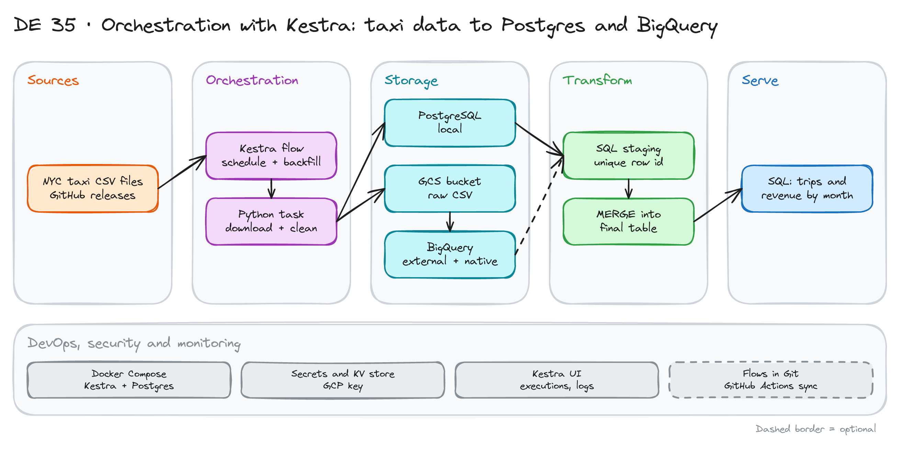

# Orchestration with Kestra: Taxi Data to Postgres and BigQuery

> **Draft.** Based on Module 2 of the [Data Engineering Zoomcamp](https://github.com/DataTalksClub/data-engineering-zoomcamp/tree/main/02-workflow-orchestration). We have not run every step yet.

## Project card

| Level | Roles | Duration | Cost | Status |
|---|---|---|---|---|
| Middle | Data Engineer | 5 assignments, ~2-4 h each | Free trial (GCP) | Draft |

## Goal

You build ETL and ELT pipelines for NYC taxi trips with Kestra. First you load one month into a local Postgres. Then you add a schedule and a backfill for many months. Then you move the same pipeline to Google Cloud: files go to GCS, tables live in BigQuery. You see the difference between ETL and ELT.

## What you will learn

- Run Kestra with Docker Compose and read its UI.
- Write a flow with inputs, tasks, variables and a Python task.
- Load CSV files into Postgres with a staging table and a merge.
- Schedule a flow and run a backfill.
- Build an ELT flow with GCS and BigQuery.
- Handle secrets and keep flows in Git.

## Who it is for

- **Data Engineer**: you learn a declarative orchestrator. It is a good contrast to Airflow.

## Tools and services

| Tool | Used for | Free option |
|---|---|---|
| Kestra | Orchestration | Yes (open source, Docker) |
| Docker Compose | Run Kestra and Postgres | Yes |
| PostgreSQL | Local database | Yes |
| Google Cloud: GCS, BigQuery | Lake and warehouse | Free trial and free tier |
| pgAdmin or DBeaver | Explore data | Yes |

## Architecture

The diagram is at the top of this page. Source file: [`images/architecture.excalidraw`](images/architecture.excalidraw). Open it at [excalidraw.com](https://excalidraw.com) to copy or edit it.

Data flow:

1. A Kestra flow downloads one monthly CSV file. Inputs: taxi type, year, month.
2. A task cleans the file and uploads it. Local: it loads into a Postgres staging table. Cloud: it uploads to GCS.
3. In the cloud, an external table reads the file. A native table is created from it.
4. A staging step adds a unique row id (a hash of key columns).
5. A `MERGE` adds only new rows to the final table.
6. A schedule runs the flow every month. A backfill fills past months.

## Dataset

- **Source:** NYC TLC taxi trips, yellow and green, as CSV files published by the Zoomcamp at [nyc-tlc-data releases](https://github.com/DataTalksClub/nyc-tlc-data/releases).
- **Size:** hundreds of MB per month for yellow taxis. Start with one month. Then do 2019 to 2020.
- **Columns:** pickup and dropoff time, locations, passenger count, distance, fare, payment type.

## Prerequisites

- Docker and SQL.
- A Google Cloud account with a free trial and a budget alert (for assignments 4 and 5).
- Do first: [Getting Started with Apache Airflow](../22_airflow_intro/) is helpful for comparison.
- New to Git, CLI or Docker? Start with [Surfalytics Module 0](https://www.youtube.com/watch?v=LJIiCLu2gr8&list=PLNCDg7zJiXhP5Z_-TXUdorz2n7sjYHHKE&index=1).

## Assignments

Work at your own pace. Each assignment shows the expected time.

### Assignment 1: Run Kestra and write a first flow (~2 h)

**Goal:** A flow with an input and a Python task.

**Steps:**

1. Write a `docker-compose.yml` with Kestra and its database. Start it.
2. Open the UI. Create a flow with one input and a log task.
3. Add a Python task that prints a message and returns an output.
4. Read the execution log and the outputs tab.

**Deliverable:** The compose file and the flow YAML.

**Done when:**

- [ ] The UI opens and the flow runs green.
- [ ] You can explain flow, task, input and output in one line each.
- [ ] Your flow is saved in a Git repo.

### Assignment 2: Load one month into Postgres (~3 h)

**Goal:** One month of taxi data in a local table.

**Steps:**

1. Add a Postgres container. Create the final table and a staging table.
2. Write a flow with inputs `taxi`, `year`, `month`.
3. Download the file, copy it into staging, add a unique row id and the file name.
4. Merge staging into the final table. Run the same month twice.

**Deliverable:** The flow and a row count after two runs.

**Done when:**

- [ ] The second run does not add duplicate rows.
- [ ] The row count matches the file.
- [ ] Staging is emptied at the end of each run.

### Assignment 3: Schedule and backfill (~3 h)

**Goal:** The flow runs by itself. History is filled.

**Steps:**

1. Add a monthly cron trigger. Use the trigger date to find the year and month.
2. Run a backfill for 2019 (12 months) for one taxi type.
3. Check the results. Count rows per month.

**Deliverable:** The trigger config and a table of rows per month.

**Done when:**

- [ ] 12 executions finish for 2019.
- [ ] No month is loaded twice.
- [ ] You can say what a backfill does and why it must be safe to repeat.

### Assignment 4: ELT on Google Cloud (~4 h)

**Goal:** The same data in GCS and BigQuery.

**Steps:**

1. Create a project, a bucket and a service account. Store the key as a Kestra secret.
2. Write a flow that uploads the file to GCS.
3. Create an external table over the file. Create a native staging table from it.
4. Merge into a final BigQuery table. Partition it by pickup date.
5. Run a monthly schedule and a backfill for yellow and green.

**Deliverable:** The flow and a BigQuery query of trips per month.

**Done when:**

- [ ] No key is in Git or in the flow file.
- [ ] The final table is partitioned and has no duplicates.
- [ ] You wrote the difference between ETL (assignment 2) and ELT (assignment 4).

### Assignment 5: Git sync and clean up (~2 h, optional extras)

**Goal:** Flows deploy from Git. Costs stay at zero.

**Steps:**

1. Sync your flows from a Git repo, or deploy them with GitHub Actions.
2. Optional: use Kestra's AI Copilot to draft a new flow. Review and fix its output.
3. Delete the cloud resources.

**Deliverable:** A repo with flows and a short note.

**Done when:**

- [ ] Changing a flow in Git changes it in Kestra.
- [ ] You reviewed all AI output before running it.
- [ ] Billing shows no running resources.

## Final result

- Local and cloud pipelines with a schedule, a backfill and safe reruns.
- Put the repo on GitHub. Add the diagram and a screenshot of the backfill.
- Interview answer: "I built idempotent ETL and ELT flows in Kestra. A staging table and a merge make reruns safe, and a backfill fills history."

## Clean up

- `docker compose down -v` for Kestra and Postgres.
- Delete the GCS bucket and the BigQuery datasets. Delete the service account key.
- Check the billing page after one day.

## Resources

- [Zoomcamp Module 2](https://github.com/DataTalksClub/data-engineering-zoomcamp/tree/main/02-workflow-orchestration): lessons and flows.
- [Kestra documentation](https://kestra.io/docs): concepts, plugins, secrets.
- [BigQuery partitioned tables](https://cloud.google.com/bigquery/docs/partitioned-tables): partition options.

## Community solutions

Share your repo in Discord. We add the best ones here.

- <Name>: <link>
