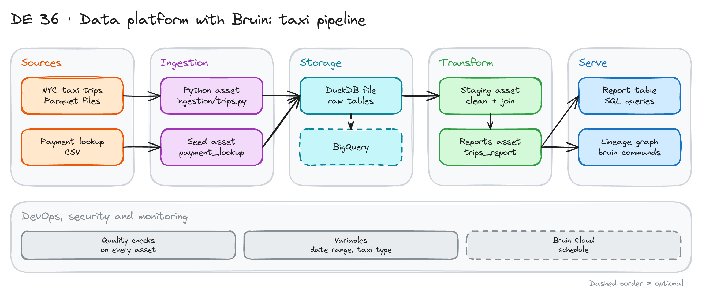

# Data Platform with Bruin: Taxi Pipeline

> **Draft.** Based on Module 5 of the [Data Engineering Zoomcamp](https://github.com/DataTalksClub/data-engineering-zoomcamp/tree/main/05-data-platforms). We have not run every step yet. Check the Bruin docs for install steps and current commands.

## Project card

| Level | Roles | Duration | Cost | Status |
|---|---|---|---|---|
| Base | Data Engineer, Analytics Engineer | 4 assignments, ~2-3 h each | Free | Draft |

## Goal

You build a complete pipeline with one tool: Bruin. Bruin handles ingestion, SQL transformations, data quality checks and lineage in one project. You load NYC taxi trips into DuckDB. You clean them in a staging layer. You build a report layer. Everything runs on your laptop.

## What you will learn

- Create a Bruin project and read its structure.
- Write a Python ingestion asset and a seed asset.
- Write SQL assets for staging and reports.
- Add quality checks to assets.
- Use pipeline variables for the date range and taxi type.
- Read the lineage graph. Move the pipeline to BigQuery (optional).

## Who it is for

- **Data Engineer**: you see a code-first platform that replaces several separate tools.
- **Analytics Engineer**: you see SQL models and quality checks in one place.

## Tools and services

| Tool | Used for | Free option |
|---|---|---|
| Bruin CLI | Ingestion, transforms, quality, lineage | Yes (open source) |
| DuckDB | Local database | Yes |
| Python | Ingestion asset | Yes |
| BigQuery | Optional cloud target | Free trial |
| Bruin Cloud | Optional scheduling | Check the docs |

## Architecture

The diagram is at the top of this page. Source file: [`images/architecture.excalidraw`](images/architecture.excalidraw). Open it at [excalidraw.com](https://excalidraw.com) to copy or edit it.

The pipeline has three layers:

1. **Ingestion:** a Python asset downloads trip files. A seed asset loads the payment type lookup.
2. **Staging:** a SQL asset removes bad rows, removes duplicates and joins the lookup.
3. **Reports:** a SQL asset aggregates trips and revenue.

Assets depend on each other. Bruin builds the lineage from these dependencies and runs assets in order.

## Dataset

- **Trips:** NYC TLC trip records, monthly Parquet files. See the [TLC data page](https://www.nyc.gov/site/tlc/about/tlc-trip-record-data.page).
- **Lookup:** a small CSV with payment types (credit card, cash and others).
- **Size:** a few million rows per month. Start with one or two months.

## Prerequisites

- Python, SQL and a terminal.
- Optional: a Google Cloud account for the BigQuery step.
- New to Git, CLI or Docker? Start with [Surfalytics Module 0](https://www.youtube.com/watch?v=LJIiCLu2gr8&list=PLNCDg7zJiXhP5Z_-TXUdorz2n7sjYHHKE&index=1).

## Assignments

Work at your own pace. Each assignment shows the expected time.

### Assignment 1: Install and run the template (~2 h)

**Goal:** A working Bruin project.

**Steps:**

1. Install the Bruin CLI from the docs.
2. Create a project from the Zoomcamp template.
3. Read `.bruin.yml`, `pipeline.yml` and the `assets/` folders.
4. Run the pipeline for one small date range.

**Deliverable:** The project in Git and the run output.

**Done when:**

- [ ] The pipeline runs end to end on DuckDB.
- [ ] You can name the three layers and one asset in each.
- [ ] The `.duckdb` file is in `.gitignore`.

### Assignment 2: Ingestion layer (~3 h)

**Goal:** Load trips for a date range you choose.

**Steps:**

1. Read the Python ingestion asset. Find where it builds the file URL.
2. Add pipeline variables: taxi type and date range.
3. Load two months of yellow trips.
4. Check row counts per month.

**Deliverable:** The ingestion asset and a count table.

**Done when:**

- [ ] Changing a variable changes what loads.
- [ ] A rerun does not double the rows (check how the asset writes).
- [ ] You wrote what happens when a month file does not exist.

### Assignment 3: Staging layer and quality checks (~3 h)

**Goal:** Clean data you can trust.

**Steps:**

1. Write the staging SQL: remove rows with null pickup time, negative fares and trips that end before they start.
2. Remove duplicates with a window function.
3. Join the payment lookup.
4. Add quality checks: not null, unique key, accepted values for payment type, positive amounts.
5. Make one check fail on purpose. Read the error.

**Deliverable:** The staging asset and the list of checks.

**Done when:**

- [ ] All checks pass on clean data.
- [ ] A broken check stops the downstream assets.
- [ ] You counted how many rows staging removed and why.

### Assignment 4: Reports, lineage and cloud (~3 h)

**Goal:** A report table and a view of the whole pipeline.

**Steps:**

1. Write the report asset: trips, revenue and average distance per day and payment type.
2. Open the lineage view. Take a screenshot.
3. Optional: add a BigQuery connection and run the pipeline on BigQuery.
4. Add a CI step that validates the project on every pull request.

**Deliverable:** The report asset, the lineage screenshot and a CI workflow.

**Done when:**

- [ ] The report answers: which payment type earns the most per day?
- [ ] CI fails when an asset has a syntax or dependency error.
- [ ] The README has the diagram and the run steps.

## Final result

- A small data platform: ingestion, staging, reports, checks and lineage in one repo.
- Put the repo on GitHub. Add the diagram and the lineage screenshot.
- Interview answer: "I built a three-layer pipeline in Bruin. Quality checks sit on the assets, and lineage comes from the dependencies."

## Clean up

Nothing to clean up for DuckDB. If you used BigQuery, delete the dataset.

## Resources

- [Zoomcamp Module 5](https://github.com/DataTalksClub/data-engineering-zoomcamp/tree/main/05-data-platforms): lessons and the template.
- [Bruin documentation](https://getbruin.com/docs): assets, checks, variables.
- [DuckDB documentation](https://duckdb.org/docs/): reading Parquet.

## Community solutions

Share your repo in Discord. We add the best ones here.

- <Name>: <link>
