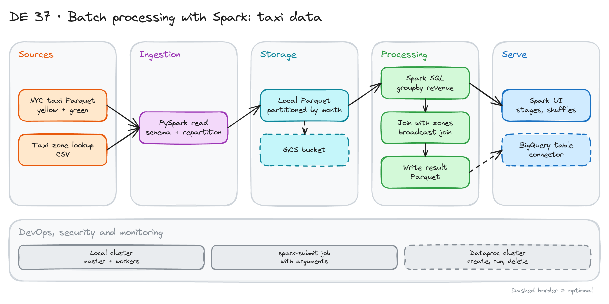

# Batch Processing with Spark: Taxi Data

> **Draft.** Based on Module 6 of the [Data Engineering Zoomcamp](https://github.com/DataTalksClub/data-engineering-zoomcamp/tree/main/06-batch). We have not run every step yet.

## Project card

| Level | Roles | Duration | Cost | Status |
|---|---|---|---|---|
| Middle | Data Engineer | 5 assignments, ~2-4 h each | Free trial (cloud part is optional) | Draft |

## Goal

You process a few months of NYC taxi trips with Spark. You read the files, fix the schema, and write them back as Parquet. You compute revenue per day and per zone. You join with the zone lookup and see how Spark plans the join. You run the same job on a local cluster with `spark-submit`. At the end you can run it on Dataproc and write the result to BigQuery.

## What you will learn

- Read and write Parquet with PySpark. Control partitions.
- Use DataFrames and Spark SQL for the same query.
- Understand group by and shuffle. Read the Spark UI.
- Use a broadcast join for a small lookup table.
- Run a job with arguments using `spark-submit`.
- Run on a cluster and read from and write to cloud storage (optional).

## Who it is for

- **Data Engineer**: you learn how Spark works under the query. It is a common interview topic.

## Tools and services

| Tool | Used for | Free option |
|---|---|---|
| Apache Spark + PySpark | Processing | Yes |
| Docker (or a local install) | Run Spark and a small cluster | Yes |
| Spark UI | Jobs, stages, shuffles | Yes |
| Google Cloud: GCS, Dataproc, BigQuery | Optional cloud run | Free trial |

## Architecture

The diagram is at the top of this page. Source file: [`images/architecture.excalidraw`](images/architecture.excalidraw). Open it at [excalidraw.com](https://excalidraw.com) to copy or edit it.

Data flow:

1. Spark reads yellow and green trip files and applies a schema.
2. It repartitions the data and writes Parquet, partitioned by month.
3. Spark SQL computes revenue per day and per zone.
4. A broadcast join adds zone names from the lookup file.
5. The result is written as Parquet. Optionally it loads into BigQuery.
6. The Spark UI shows stages and shuffles.

## Dataset

- **Trips:** NYC TLC trip records, yellow and green, monthly Parquet. See the [TLC data page](https://www.nyc.gov/site/tlc/about/tlc-trip-record-data.page).
- **Lookup:** the taxi zone lookup CSV from the same page.
- **Size:** use 3 to 6 months. Several million rows per month.

## Prerequisites

- Python, SQL and Docker.
- Optional: a Google Cloud account for assignment 5.
- Do first: [Apache Spark Basics with PySpark and Docker](../06_spark_projects/).
- New to Git, CLI or Docker? Start with [Surfalytics Module 0](https://www.youtube.com/watch?v=LJIiCLu2gr8&list=PLNCDg7zJiXhP5Z_-TXUdorz2n7sjYHHKE&index=1).

## Assignments

Work at your own pace. Each assignment shows the expected time.

### Assignment 1: Read, fix the schema, write Parquet (~3 h)

**Goal:** Clean, partitioned Parquet from raw files.

**Steps:**

1. Start Spark in Docker or locally. Open the Spark UI.
2. Read one month. Print the schema. Note columns with the wrong type.
3. Set an explicit schema. Cast timestamps.
4. Repartition. Write Parquet partitioned by year and month.
5. Compare file sizes and the number of files for 4 and for 24 partitions.

**Deliverable:** A notebook or script and a note on partition choice.

**Done when:**

- [ ] The output Parquet has the right types.
- [ ] You can explain why too many tiny files are a problem.
- [ ] You can open the job in the Spark UI.

### Assignment 2: Revenue per day with DataFrames and SQL (~3 h)

**Goal:** One query two ways.

**Steps:**

1. Compute revenue, trip count and average distance per day with the DataFrame API.
2. Write the same query in Spark SQL.
3. Compare the results. Compare the plans with `explain()`.

**Deliverable:** Both versions and the result table.

**Done when:**

- [ ] Both versions give the same numbers.
- [ ] You can show where the shuffle happens in the plan.
- [ ] The result covers all months you loaded.

### Assignment 3: Joins and the Spark UI (~3 h)

**Goal:** Add zone names. See how the join runs.

**Steps:**

1. Read the zone lookup file.
2. Join trips to zones by pickup location. First run a normal join.
3. Run again with a broadcast hint. Compare stages and run time in the Spark UI.
4. Compute revenue per zone and month.

**Deliverable:** A table with times for both joins and a screenshot of each plan.

**Done when:**

- [ ] The broadcast join avoids a shuffle of the big table.
- [ ] You wrote why the lookup is small enough to broadcast.
- [ ] Revenue per zone adds up to the total.

### Assignment 4: Local cluster and `spark-submit` (~3 h)

**Goal:** Run the job as a program, not a notebook.

**Steps:**

1. Turn your code into a Python script with arguments: input path, output path, year, month.
2. Start a local Spark cluster: a master and two workers (Docker Compose).
3. Run the script with `spark-submit` on the cluster.
4. Check the job in the master UI.

**Deliverable:** The script, the compose file and the submit command.

**Done when:**

- [ ] You can run the job for a different month by changing an argument only.
- [ ] Both workers take part in the job.
- [ ] Logs show success or a clear error.

### Assignment 5: Cloud run on Dataproc (~4 h, optional)

**Goal:** The same job in the cloud.

**Steps:**

1. Upload the input files to a GCS bucket.
2. Create a small Dataproc cluster. Submit the job with GCS paths.
3. Write the result to BigQuery with the Spark BigQuery connector.
4. Delete the cluster as soon as the job ends.

**Deliverable:** The submit command and a BigQuery query on the result.

**Done when:**

- [ ] The result table exists in BigQuery.
- [ ] The cluster is deleted.
- [ ] You wrote the cost and how long the cluster ran.

## Final result

- A PySpark job that reads, joins, aggregates and writes. It runs locally, on a cluster and, optionally, on Dataproc.
- Put the repo on GitHub. Add the diagram and a Spark UI screenshot of both joins.
- Interview answer: "I processed taxi data with Spark. I used a broadcast join for the small lookup and checked the plan and the shuffle in the Spark UI."

## Clean up

- Stop containers with `docker compose down -v`.
- Delete the Dataproc cluster, the bucket and the BigQuery dataset.
- Check billing after one day.

## Resources

- [Zoomcamp Module 6](https://github.com/DataTalksClub/data-engineering-zoomcamp/tree/main/06-batch): lessons and code.
- [Spark SQL guide](https://spark.apache.org/docs/latest/sql-programming-guide.html): DataFrames and SQL.
- [Dataproc documentation](https://cloud.google.com/dataproc/docs): clusters and jobs.

## Community solutions

Share your repo in Discord. We add the best ones here.

- <Name>: <link>
