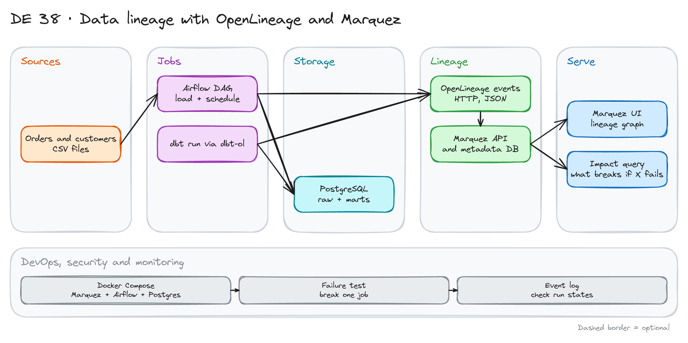

# Data Lineage with OpenLineage and Marquez

> **Draft.** The outline and the plan are ready. We have not run every step yet. Port numbers and package names change between versions. Check the Marquez and OpenLineage docs.

## Project card

| Level | Roles | Duration | Cost | Status |
|---|---|---|---|---|
| Middle | Data Engineer, Analytics Engineer | 4 assignments, ~3-4 h each | Free | Draft |

## Goal

A dashboard shows a wrong number. Which job broke? Which tables and reports are affected? You build a lineage system that answers this. Airflow and dbt send OpenLineage events to Marquez. Marquez draws the graph of jobs and datasets. You break a job on purpose and use the graph to find the impact.

## What you will learn

- Explain what OpenLineage is (a standard for lineage events) and what Marquez is (a server that stores and shows them).
- Run Marquez, Airflow and Postgres with Docker Compose.
- Send lineage from Airflow tasks and from dbt runs.
- Make dataset names match across tools, so the graph connects.
- Read job runs, states and dataset versions in the UI and the API.
- Use lineage to find the impact of a failure.

## Who it is for

- **Data Engineer**: you learn how to make pipelines observable.
- **Analytics Engineer**: you see how dbt models appear in a lineage graph.

## Tools and services

| Tool | Used for | Free option |
|---|---|---|
| OpenLineage | Event standard and integrations | Yes |
| Marquez | Lineage server, API and UI | Yes (open source) |
| Apache Airflow with the OpenLineage provider | Load jobs and events | Yes |
| dbt Core with the OpenLineage wrapper (`dbt-ol`) | Model lineage | Yes |
| PostgreSQL | Data and warehouse | Yes |
| Docker Compose | Run everything | Yes |

## Architecture

The diagram is at the top of this page. Source file: [`images/architecture.excalidraw`](images/architecture.excalidraw). Open it at [excalidraw.com](https://excalidraw.com) to copy or edit it.

Data flow:

1. An Airflow DAG loads `orders` and `customers` CSV files into Postgres.
2. A dbt run builds staging models and a mart in the same Postgres.
3. Airflow and `dbt-ol` send OpenLineage events (start, complete, fail) over HTTP to Marquez.
4. Marquez stores jobs, runs and datasets in its own database.
5. You read the graph in the UI and call the API for upstream and downstream datasets.

## Dataset

You generate a small dataset. No download needed.

- **`customers`:** 1,000 rows. **`orders`:** 10,000 rows with `customer_id`, `amount`, `status`, `created_at`.
- **Models:** `stg_customers`, `stg_orders`, `fct_orders`, `customer_revenue`.

## Prerequisites

- Docker with 6 GB of memory or more.
- SQL and basic Airflow and dbt.
- Do first: [Getting Started with Apache Airflow](../22_airflow_intro/) and [dbt Fundamentals](../18_dbt_intro/).
- New to Git, CLI or Docker? Start with [Surfalytics Module 0](https://www.youtube.com/watch?v=LJIiCLu2gr8&list=PLNCDg7zJiXhP5Z_-TXUdorz2n7sjYHHKE&index=1).

## Assignments

Work at your own pace. Each assignment shows the expected time.

### Assignment 1: Run the stack (~3 h)

**Goal:** Marquez, Airflow and Postgres run together.

**Steps:**

1. Start Marquez with Docker. Open the UI and the API.
2. Add Airflow and a data Postgres to your Docker Compose, on the same network.
3. Send one test OpenLineage event with `curl`. Find it in the UI.

**Deliverable:** The compose file and a screenshot of the test job in the UI.

**Done when:**

- [ ] The UI shows your test job and dataset.
- [ ] Airflow can reach the Marquez URL from inside its container.
- [ ] You can explain job, run and dataset in one line each.

### Assignment 2: Lineage from Airflow (~4 h)

**Goal:** Airflow tasks appear in the graph with their tables.

**Steps:**

1. Turn on the OpenLineage provider in Airflow. Set the Marquez URL and a namespace.
2. Write a DAG: load `customers` and `orders` into Postgres raw tables with SQL tasks.
3. Run it. Open the graph in Marquez.
4. Check that input and output tables are shown.

**Deliverable:** The DAG and a lineage screenshot.

**Done when:**

- [ ] Each task shows as a job with its datasets.
- [ ] Run history shows start and complete times.
- [ ] You know which tasks give table-level lineage and which give none.

### Assignment 3: Add dbt and connect the graph (~4 h)

**Goal:** One graph from raw tables to the mart.

**Steps:**

1. Create the dbt project with the four models.
2. Run it with `dbt-ol` so it sends events.
3. Compare dataset names from Airflow and from dbt. Fix any that differ (host, port, database, schema).
4. Run the DAG and dbt in order. Check one connected graph.

**Deliverable:** The dbt project and a screenshot of the full graph.

**Done when:**

- [ ] The graph goes from `raw.orders` to `customer_revenue` with no gap.
- [ ] Dataset names match on both sides.
- [ ] You wrote the naming rule you used.

**Hints:** Lineage breaks when two tools name the same table in two ways. This is the main practical problem.

### Assignment 4: Failure and impact (~3 h)

**Goal:** Use lineage to answer: what did this failure break?

**Steps:**

1. Break the load of `orders` on purpose (a bad file).
2. Run the pipeline. Find the failed run in Marquez.
3. Use the UI and the API to list all downstream datasets.
4. Write a short runbook: who to tell, what to re-run, how to check.

**Deliverable:** The runbook and the API calls you used.

**Done when:**

- [ ] The failed run shows as failed in Marquez.
- [ ] Your downstream list matches the dbt models.
- [ ] The runbook fits on one page.

## Final result

- A running lineage system, with one graph across Airflow and dbt, and a failure runbook.
- Put the repo on GitHub. Add the diagram and the graph screenshots.
- Interview answer: "I set up OpenLineage with Marquez for Airflow and dbt. When a job failed I used the lineage graph to find every affected table."

## Clean up

Run `docker compose down -v` for all stacks.

## Resources

- [OpenLineage](https://openlineage.io/docs/): the standard and integrations.
- [Marquez](https://marquezproject.ai/docs/quickstart): quickstart and API.
- [Airflow OpenLineage provider](https://airflow.apache.org/docs/apache-airflow-providers-openlineage/stable/index.html): configuration.

## Community solutions

Share your repo in Discord. We add the best ones here.

- <Name>: <link>
