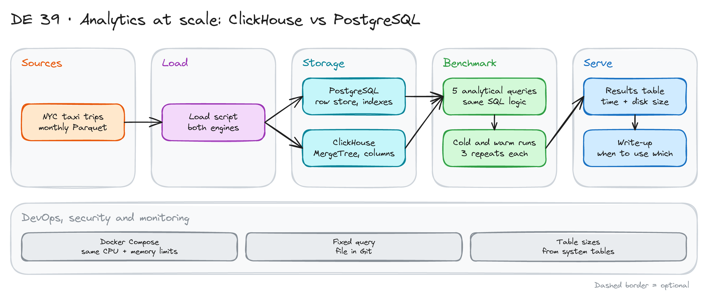

# Analytics at Scale: ClickHouse vs PostgreSQL

> **Draft.** The outline and the plan are ready. We have not run every step yet. Plan for about 20 GB of free disk.

## Project card

| Level | Roles | Duration | Cost | Status |
|---|---|---|---|---|
| Middle | Data Engineer, Analytics Engineer | 5 assignments, ~2-4 h each | Free | Draft |

## Goal

A row store and a column store answer the same analytical questions at very different speeds. You load tens of millions of taxi trips into PostgreSQL and into ClickHouse. You run the same five queries on both. You measure time and disk size. Then you tune each engine and measure again. At the end you write when to use which.

## What you will learn

- Explain row store versus column store with real numbers.
- Load Parquet data into PostgreSQL and ClickHouse.
- Choose a ClickHouse `MergeTree` key and a PostgreSQL index and partition plan.
- Run a fair benchmark: same data, same limits, repeated runs.
- Read table sizes from system tables.
- Write a decision note based on evidence.

## Who it is for

- **Data Engineer**: you learn how storage layout drives query speed.
- **Analytics Engineer**: you learn why some warehouses are fast on wide scans.

## Tools and services

| Tool | Used for | Free option |
|---|---|---|
| PostgreSQL | Row store | Yes |
| ClickHouse | Column store | Yes (open source) |
| DuckDB | Convert Parquet to CSV, check results | Yes |
| Docker Compose | Run both with equal CPU and memory limits | Yes |
| Python | Benchmark script | Yes |

## Architecture

The diagram is at the top of this page. Source file: [`images/architecture.excalidraw`](images/architecture.excalidraw). Open it at [excalidraw.com](https://excalidraw.com) to copy or edit it.

Data flow:

1. Download 12 months of yellow taxi trips (Parquet).
2. A load script writes the same data into PostgreSQL and ClickHouse.
3. A benchmark runs five queries, three times each, cold and warm.
4. The script writes times and table sizes to a results table.
5. You write the decision note.

## Dataset

- **Source:** NYC TLC yellow taxi trip records, monthly Parquet files. See the [TLC data page](https://www.nyc.gov/site/tlc/about/tlc-trip-record-data.page).
- **Size:** 12 months is about 40 million rows. You can use fewer months first. You can add more later.
- **Queries (suggested):**
  1. Trips and revenue per month.
  2. Average fare by passenger count.
  3. Top 20 pickup zones by revenue.
  4. Trips per hour of day.
  5. 95th percentile of trip distance per month.

## Prerequisites

- Docker with 8 GB of memory or more, and 20 GB of free disk.
- SQL and Python.
- New to Git, CLI or Docker? Start with [Surfalytics Module 0](https://www.youtube.com/watch?v=LJIiCLu2gr8&list=PLNCDg7zJiXhP5Z_-TXUdorz2n7sjYHHKE&index=1).

## Assignments

Work at your own pace. Each assignment shows the expected time.

### Assignment 1: Set up and download (~2 h)

**Goal:** Both databases run with the same limits.

**Steps:**

1. Write a Docker Compose file with PostgreSQL and ClickHouse. Give each the same CPU and memory limits.
2. Download 3 months of Parquet files first.
3. Write the table definitions for both engines with the same columns.

**Deliverable:** The compose file, the DDL and the data folder.

**Done when:**

- [ ] Both databases accept connections.
- [ ] The limits are set in the compose file.
- [ ] Column names and types match across engines.

### Assignment 2: Load and measure (~3 h)

**Goal:** Same rows in both. Know how long the load took.

**Steps:**

1. Load into ClickHouse (for example with `INSERT ... SELECT` from the Parquet files).
2. Load into PostgreSQL (convert to CSV with DuckDB then `COPY`, or use DuckDB's Postgres extension).
3. Record load time and row count for each.
4. Read the table size: PostgreSQL with `pg_total_relation_size`, ClickHouse from `system.parts`.

**Deliverable:** A table with rows, load time and size for each engine.

**Done when:**

- [ ] Row counts are equal.
- [ ] You can explain the size difference in two sentences.
- [ ] You added the remaining months and measured again.

### Assignment 3: Benchmark five queries (~4 h)

**Goal:** A fair comparison, before any tuning.

**Steps:**

1. Write the five queries in SQL for both engines. Keep the logic the same.
2. Write a Python script. For each query: one cold run, then three warm runs. Save the median.
3. Check that results match across engines (same counts and sums).

**Deliverable:** The query file, the script and a results table.

**Done when:**

- [ ] Results match between engines.
- [ ] You restart containers or clear caches before the cold runs.
- [ ] The results table is saved in Git.

### Assignment 4: Tune both engines (~4 h)

**Goal:** Give each engine a fair chance.

**Steps:**

1. PostgreSQL: add indexes that help your queries, try partitioning by month and try parallel query settings. Measure each change alone.
2. ClickHouse: choose the `ORDER BY` key and the partition key. Use `LowCardinality` for low-cardinality text columns. Measure again.
3. Keep a log of each change and its effect.

**Deliverable:** A tuning log with before and after times.

**Done when:**

- [ ] Each change has a measured effect, good or bad.
- [ ] You found at least one change that did not help.
- [ ] The final results table has both untuned and tuned numbers.

### Assignment 5: Decision note (~2 h)

**Goal:** Advice for a team.

**Steps:**

1. Write a 1-page note: which engine for which workload.
2. Cover: wide scans and aggregates, point lookups, updates and deletes, many small writes, operations effort.
3. Add one chart of the results.

**Deliverable:** The note and the chart.

**Done when:**

- [ ] Every claim has a number from your results or a clear reason.
- [ ] The note says what you did not test.
- [ ] A teammate can repeat the benchmark from your README.

## Final result

- A repeatable benchmark, a tuning log and a decision note.
- Put the repo on GitHub. Add the diagram and the results chart.
- Interview answer: "I loaded 40 million rows into PostgreSQL and ClickHouse and ran the same queries on both. The column store won on scans and used less disk. I wrote down where PostgreSQL is still the better choice."

## Clean up

Run `docker compose down -v`. Delete the Parquet files if you need the disk space.

## Resources

- [ClickHouse documentation](https://clickhouse.com/docs): MergeTree and data loading.
- [PostgreSQL partitioning](https://www.postgresql.org/docs/current/ddl-partitioning.html): table partitions.
- [TLC trip record data](https://www.nyc.gov/site/tlc/about/tlc-trip-record-data.page): the dataset.

## Community solutions

Share your repo in Discord. We add the best ones here.

- <Name>: <link>
