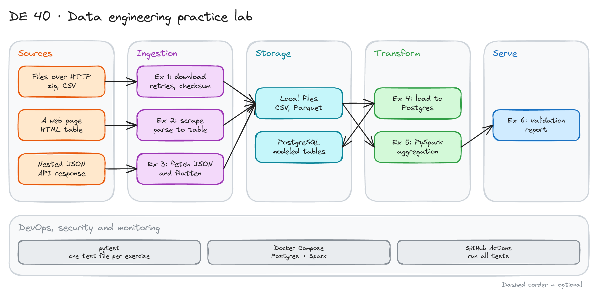

# Data Engineering Practice Lab



> **Draft.** The outline and the plan are ready. The exercise folders and tests are not written yet. See "Starter layout" below.

## Project card

| Level | Roles | Duration | Cost | Status |
|---|---|---|---|---|
| Base | Data Engineer, Analytics Engineer | 6 exercises, ~1-3 h each | Free | Draft |

## Goal

You solve six small exercises that cover the daily work of a data engineer: download files, scrape a web page, flatten JSON, model and load a database, aggregate with Spark and validate data. Each exercise has tests. You are done when the tests pass. The exercises get harder as you go.

## What you will learn

- Download files safely: retries, timeouts, checksums.
- Parse HTML into a table.
- Flatten nested JSON into rows.
- Design tables with keys and load them into PostgreSQL.
- Aggregate a large file with PySpark.
- Write data validation rules and a report.

## Who it is for

- **Data Engineer**: you build the base skills that every pipeline needs.
- **Analytics Engineer**: you practice Python, SQL and validation.

## Tools and services

| Tool | Used for | Free option |
|---|---|---|
| Python 3.10+ | All exercises | Yes |
| `requests`, `BeautifulSoup`, `pandas` | Download, scrape, tables | Yes |
| PostgreSQL in Docker | Exercise 4 | Yes |
| PySpark | Exercise 5 | Yes |
| `pandera` (or Great Expectations) | Exercise 6 | Yes |
| `pytest` | Tests for every exercise | Yes |
| GitHub Actions | Run all tests | Yes |

## Architecture

The diagram is at the top of this page. Source file: [`images/architecture.excalidraw`](images/architecture.excalidraw). Open it at [excalidraw.com](https://excalidraw.com) to copy or edit it.

The exercises connect in one small flow:

1. Ex 1 downloads files. Ex 2 scrapes a table. Ex 3 fetches and flattens JSON. All write local files.
2. Ex 4 loads the data into PostgreSQL with a model you design.
3. Ex 5 aggregates a large Parquet file with PySpark.
4. Ex 6 validates the results and writes a report.

## Dataset

- **Files (Ex 1, 5):** [NYC TLC trip records](https://www.nyc.gov/site/tlc/about/tlc-trip-record-data.page) (Parquet) and the taxi zone lookup (CSV).
- **Web page (Ex 2):** a public page with an HTML table. For example a Wikipedia list of countries with a statistic. Pick a stable page.
- **JSON (Ex 3):** a free API with nested arrays, for example [Open-Meteo](https://open-meteo.com/) hourly weather. No key needed.
- **Size:** small, except the Parquet file in Ex 5 (a few million rows).

## Prerequisites

- Python basics and SQL basics.
- Docker for Ex 4 and 5.
- New to Git, CLI or Docker? Start with [Surfalytics Module 0](https://www.youtube.com/watch?v=LJIiCLu2gr8&list=PLNCDg7zJiXhP5Z_-TXUdorz2n7sjYHHKE&index=1).

## Starter layout

```text
data-engineering-practice-lab/
├── docker-compose.yml        # Postgres and a Spark image
├── pyproject.toml
├── exercises/
│   ├── ex1_download/         # README.md, solution.py (stub), tests/
│   ├── ex2_scrape/
│   ├── ex3_flatten_json/
│   ├── ex4_postgres_model/
│   ├── ex5_pyspark_agg/
│   └── ex6_validation/
└── .github/workflows/tests.yml
```

Each exercise folder has a `README.md` with the task, a stub file to fill in and a `tests/` folder.

## Assignments

Each assignment is one exercise. Work at your own pace.

### Exercise 1: Download files (~1 h)

**Goal:** Download a list of files in a safe way.

**Steps:**

1. Write `download(url, dest)` with a timeout and retries with backoff.
2. Stream large files to disk. Do not load them in memory.
3. Skip a file that already exists and has the right size or checksum.
4. Handle a bad URL without stopping the whole run.

**Deliverable:** `solution.py` and passing tests.

**Done when:**

- [ ] Tests pass, including a test with a failing URL.
- [ ] A second run downloads nothing.
- [ ] A broken download never leaves a half file.

### Exercise 2: Scrape a table (~2 h)

**Goal:** Turn an HTML table into a clean DataFrame.

**Steps:**

1. Download the page. Parse the table with `BeautifulSoup`.
2. Clean the numbers: remove commas, footnote marks and units.
3. Set the right data types. Save to CSV.

**Deliverable:** `solution.py` and tests that use a saved copy of the page.

**Done when:**

- [ ] Tests use a local HTML file, not the live site.
- [ ] Numeric columns are numbers, not strings.
- [ ] Rows with missing values are kept and marked.

### Exercise 3: Flatten JSON (~2 h)

**Goal:** One row per hour from a nested API response.

**Steps:**

1. Call the API once. Save the raw JSON.
2. Flatten the arrays (time, temperature, wind) into rows.
3. Add the units from the response as column metadata or a note.

**Deliverable:** `solution.py` and tests with a saved JSON file.

**Done when:**

- [ ] Row count equals the length of the time array.
- [ ] No column holds a list or a dict.
- [ ] The function works for two different locations.

### Exercise 4: Model and load PostgreSQL (~3 h)

**Goal:** Tables with keys, loaded from your files.

**Steps:**

1. Design tables for the zone lookup and the weather rows. Add primary keys and one foreign key.
2. Write the DDL. Load the data with `COPY` or batch inserts.
3. Make the load safe to repeat (`ON CONFLICT` or truncate and load).
4. Write a query that joins both tables.

**Deliverable:** `schema.sql`, the loader and tests.

**Done when:**

- [ ] Running the loader twice gives the same row counts.
- [ ] Inserting a row with a bad foreign key fails.
- [ ] The join query returns the expected rows on test data.

### Exercise 5: Aggregate with PySpark (~3 h)

**Goal:** A daily summary of a large file.

**Steps:**

1. Read one month of taxi trips. Select needed columns.
2. Compute trips, revenue and average distance per day.
3. Add the zone name with a join to the lookup.
4. Write the result as Parquet.

**Deliverable:** `solution.py` and a test on a small sample file.

**Done when:**

- [ ] The test on the sample gives the exact expected numbers.
- [ ] Your job reads only the columns it needs.
- [ ] The output has one row per day and zone.

### Exercise 6: Validate the data (~2 h)

**Goal:** Rules, not guesses.

**Steps:**

1. Write a schema with checks: types, ranges, allowed values, no duplicates.
2. Run it on the Exercise 5 result and on a broken copy.
3. Write a short report: which rules failed and how many rows.

**Deliverable:** The validation code and the report for the broken copy.

**Done when:**

- [ ] The good data passes. The broken copy fails with clear messages.
- [ ] At least five rules exist, with one for each type: type, range, set, unique, null.
- [ ] The report is saved by the script.

## Final result

- A repo with six solved, tested exercises and CI that runs all tests.
- Put the repo on GitHub. Add the diagram to the README.
- Interview answer: "I built a practice repo covering downloads, scraping, JSON flattening, Postgres modeling, PySpark and validation. Every exercise has tests, and CI runs them."

## Clean up

Run `docker compose down -v`. Delete downloaded files if you need the disk space.

## Resources

- [pytest documentation](https://docs.pytest.org/): fixtures and parametrize.
- [pandera](https://pandera.readthedocs.io/): data validation for DataFrames.
- [PySpark documentation](https://spark.apache.org/docs/latest/api/python/): DataFrame API.

## Community solutions

Share your repo in Discord. We add the best ones here.

- <Name>: <link>
