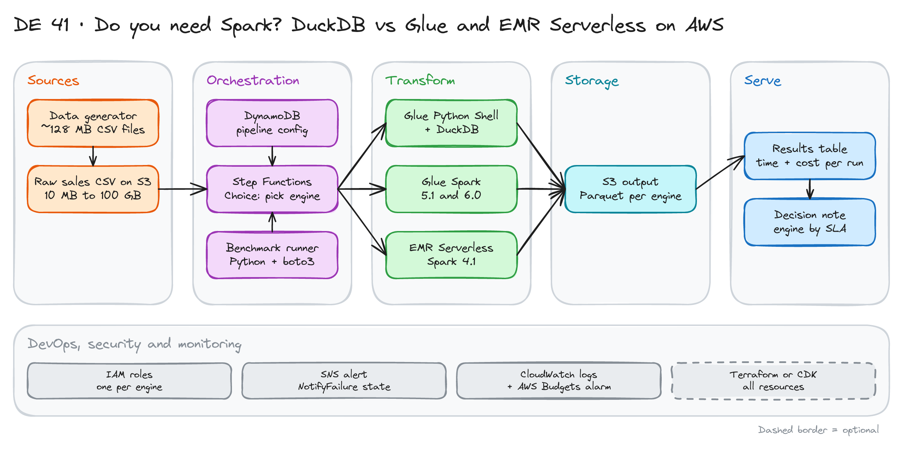

# Do You Need Spark? DuckDB vs Glue and EMR Serverless on AWS



> **Draft.** The outline and the plan are ready. We tested the data generator and the SQL locally with DuckDB 1.4.5. The AWS steps are not tested yet. The full benchmark costs about $10 if you delete the data at the end. Set a budget alarm before you start.

## Project card

| Level | Roles | Duration | Cost | Status |
|---|---|---|---|---|
| Senior | Data Engineer, DataOps Engineer | 6 assignments, ~3-5 h each | Paid (~$10) | Draft |

## Goal

Many teams run every ETL job on Spark, even small ones. Is that the right choice? You build one config-driven pipeline on AWS. It runs the same SQL on four engines: DuckDB on Glue Python Shell, Glue Spark 5.1, Glue Spark 6.0 and EMR Serverless. You process 10 MB to 100 GB of sales data and measure time and cost for each run. At the end you write when to use which engine.

This project repeats a public benchmark by [Marcela Monteiro Montenegro Gallo](https://www.linkedin.com/in/marcelagallo/). It adds what the benchmark did not test: Glue 6.0 with its lower price.

## What you will learn

- Build one pipeline that runs on many engines. The engine is a config value, not code.
- Run the same SQL on DuckDB and on Spark, and prove that the results match.
- Calculate the cost of one job run from billed usage.
- Tell the difference between billed time and end-to-end time.
- Tune DuckDB to process data that is larger than memory.
- Choose an engine with numbers: volume, SLA and query shape.

## Who it is for

- **Data Engineer**: you choose engines by evidence, not by habit.
- **DataOps Engineer**: you learn where the cost of a data job comes from and how to track it per run.

## Tools and services

| Tool | Used for | Free option |
|---|---|---|
| AWS Glue Python Shell | Runs DuckDB on a small worker (1/16 DPU) | No |
| DuckDB | SQL engine inside the Python Shell job | Yes (open source) |
| AWS Glue for Spark 5.1 and 6.0 | Managed Spark jobs | No |
| Amazon EMR Serverless | Spark without a cluster to manage | No |
| AWS Step Functions | Runs the pipeline and picks the engine | Free tier covers this project |
| Amazon DynamoDB | Pipeline config | Free tier covers this project |
| Amazon S3 | Raw CSV, Parquet output, scripts and results | No (about 190 GB of data) |
| Amazon SNS | Email when a run fails | Free tier covers this project |
| Python, boto3 | Data generator, benchmark runner, cost math | Yes |
| PySpark | Local test of the Spark code | Yes |
| Terraform or AWS CDK (optional) | Create all resources as code | Yes |

## Architecture

The diagram is at the top of this page. Source file: [`images/architecture.excalidraw`](images/architecture.excalidraw). Open it at [excalidraw.com](https://excalidraw.com) to copy or edit it.

Data flow:

1. A generator writes synthetic sales CSV files to S3, about 128 MB per file. There is one prefix per size, from 10 MB to 100 GB.
2. DynamoDB holds one config item per pipeline: engine, job name, SQL path, output path, capacity and timeout.
3. The benchmark runner starts a Step Functions execution with the pipeline ID and the source path.
4. Step Functions reads the config. A `Choice` state sends the run to a Glue job or to EMR Serverless. It waits until the job ends.
5. The job runs the same SQL file and writes Parquet to S3.
6. If a job fails, the `NotifyFailure` state sends an SNS email.
7. The runner reads the billed usage from the Glue and EMR APIs. It writes one row per run to a results table.
8. You turn the results into charts and a decision note.

## Dataset

- **Source:** synthetic sales data. You generate it in assignment 1.
- **Columns:** `id` (BIGINT), `customer_id` (INTEGER, 1 to 5,000), `amount` (DECIMAL(10,2), about 2% negative for refunds), `sale_date` (DATE, 365 days).
- **Files:** CSV with a header, about 128 MB per file. One row is about 32 bytes, so 1 GB is about 31 million rows.
- **Sizes:** 10 MB, 100 MB, 1 GB, 5 GB, 10 GB, 25 GB, 50 GB and 100 GB. About 190 GB in total.
- **Transformation:** read the CSV, keep rows with `amount > 0`, group by `customer_id` and `sale_date`, write Parquet.
- **Expected output:** at most 5,000 × 365 = 1,825,000 rows. From 1 GB up you get all 1,825,000. The original benchmark had the same number.

## Reference results

The original benchmark ran in `us-east-1` on x86. Use these numbers to check the shape of your results. Your numbers will differ.

| Engine | 10 GB | 100 GB |
|---|---|---|
| Glue Python Shell + DuckDB, 1/16 DPU | $0.0014, 181 s | ~28 min, the cheapest |
| EMR Serverless 7.5 (Spark 3.5) | $0.036, 234 s | ~4 min, $0.184 |
| Glue Spark 5.0 (Spark 3.5) | $0.090, 370 s | ~7.4 min, ~2.9× the EMR cost |
| Glue Spark 4.0 (Spark 3.3) | $0.123, 503 s | ~9 min |

- At 10 GB the Spark engines used the smallest size. At 100 GB they used 10 workers. DuckDB used 1/16 DPU for all sizes.
- DuckDB was the cheapest at every size. At 100 GB, EMR Serverless was about 7 times faster and about 14 times more expensive.
- Glue Python Shell with 1 DPU failed at 25 GB and up with `OutOfMemoryException: failed to offload data block`.

## Prerequisites

- An AWS account where you can create IAM roles. AWS CLI v2 is set up.
- Python 3.11 or newer with `boto3` and `duckdb`. For the local Spark test: PySpark 4.1 with Java 17, or Docker.
- SQL, Python and basic Spark.
- Do these first: [Batch Processing with Spark: Taxi Data](../37_spark_taxi_batch/) and [End-to-End ETL Pipeline with AWS](../11_end_to_end_de_project_with_aws/). [Terraform 101](../../dataops-projects/02_terraform_101/) helps with the optional IaC part.
- New to Git, CLI or Docker? Start with [Surfalytics Module 0](https://www.youtube.com/watch?v=LJIiCLu2gr8&list=PLNCDg7zJiXhP5Z_-TXUdorz2n7sjYHHKE&index=1).

## Assignments

Work at your own pace. Each assignment shows the expected time.

### Assignment 1: Set up AWS and generate the data (~4 h)

**Goal:** One S3 bucket with the same sales data in eight sizes. A budget alarm protects you.

**Steps:**

1. Pick one region and use it for everything. The original benchmark used `us-east-1`.
2. Create an AWS Budgets alarm at $10.
3. Create an S3 bucket with these prefixes: `raw/size=10mb/` to `raw/size=100gb/`, `output/`, `sql/`, `scripts/` and `results/`.
4. Write the generator. Use the columns from the [Dataset](#dataset) section.
5. Run it on your laptop for 10 MB and 100 MB. Run it inside AWS for 1 GB and up, for example as a Glue Python Shell job with 1 DPU. Do not upload 100 GB from your laptop.
6. For each prefix, record the size, the file count and the row count.

**Deliverable:** The generator script and a table with size, files and rows for each prefix.

**Done when:**

- [ ] The budget alarm is active.
- [ ] Each prefix is within 10% of its target size.
- [ ] Files are about 128 MB. Small sizes have one file.
- [ ] The table is saved in Git.

**Hints:**

- DuckDB can make the rows with `range()` and `random()`. It can write straight to S3 and split the files: `COPY (...) TO 's3://<bucket>/raw/size=10gb/' (FORMAT csv, HEADER, FILE_SIZE_BYTES '128MB')`.
- Generate 25, 50 and 100 GB only when you start assignment 5. Delete them when you finish. S3 storage is part of the cost.

### Assignment 2: One SQL file, two engines, on your laptop (~3 h)

**Goal:** The same SQL gives the same result in DuckDB and in Spark.

**Steps:**

1. Write `transform.sql`. It reads from a view named `sales`, keeps rows with `amount > 0` and groups by `customer_id` and `sale_date`. It returns `orders` (count) and `total_amount` (sum).
2. Write a DuckDB runner. It creates the `sales` view over the CSV files with an explicit schema, runs `transform.sql` and writes Parquet.
3. Write a PySpark runner that does the same.
4. Run both on 10 MB and 100 MB. Compare the row count, the sum of `orders` and the sum of `total_amount`.

**Deliverable:** `transform.sql`, `run_duckdb.py`, `run_spark.py` and a check script.

**Done when:**

- [ ] Both runners use the same `transform.sql` file.
- [ ] Both read the CSV with an explicit schema. No schema inference.
- [ ] The row count and the totals match exactly.

**Hints:**

- Spark `inferSchema` reads the data one more time. It makes Spark look slower than it is.
- Use plain SQL that both engines understand. Function names can differ: DuckDB has `strftime()`, Spark has `date_format()`.
- Use PySpark 4.1 locally. Glue 6.0 and the EMR Serverless release in this project run Spark 4.1.

### Assignment 3: Build the config-driven pipeline (~5 h)

**Goal:** One state machine runs any engine. To change the engine, you change one config value.

**Steps:**

1. Create a DynamoDB table `pipeline_config` with the key `pipeline_id`. Add one item per engine. Fields: `engine` (`glue` or `emr`), `job_name` or `application_id`, `sql_path`, `output_path`, `capacity` and `timeout_minutes`.
2. Create the four engines. Each one runs the same `transform.sql` from S3:
   - Glue Python Shell job with DuckDB, 1/16 DPU.
   - Glue Spark job on Glue 5.1 with 2 G.1X workers.
   - Glue Spark job on Glue 6.0 with 2 G.1X workers.
   - EMR Serverless application with a Spark 4.1 release (for example `emr-spark-8.1.0`) on x86_64.
3. Build the state machine: `GetConfig` (DynamoDB `GetItem`) → `RouteEngine` (`Choice`) → `RunGlueJob` or `RunEmrServerless`. Use the `.sync` integrations, so Step Functions waits for the job: `arn:aws:states:::glue:startJobRun.sync` and `arn:aws:states:::emr-serverless:startJobRun.sync`.
4. Add a `Catch` to both job states. It goes to `NotifyFailure`, which publishes to an SNS topic with your email.
5. Create one IAM role per engine. Each role can access only the S3 prefixes it needs.
6. Start the state machine for each engine with the 10 MB data.

**Deliverable:** The state machine definition, job scripts, config items and IAM policies in Git.

**Done when:**

- [ ] All four engines finish on 10 MB from the same state machine.
- [ ] You switch the engine by changing the config item only.
- [ ] A run with a wrong path sends you an SNS email.
- [ ] The output row counts match assignment 2.

**Hints:**

- The `Choice` state from the original benchmark:

  ```json
  "RouteEngine": {
    "Type": "Choice",
    "Choices": [
      { "Variable": "$.cfg.Item.engine.S", "StringEquals": "emr", "Next": "RunEmrServerless" }
    ],
    "Default": "RunGlueJob"
  }
  ```

- Pass the config values to the jobs as job arguments. Then the jobs do not need to read DynamoDB.
- Glue Python Shell runs Python 3.9. DuckDB 1.5 and newer need Python 3.10 or newer. Pin the 1.4 line: `--additional-python-modules duckdb==1.4.5`.
- DuckDB needs S3 credentials. Read the job role credentials with `boto3` and pass them to `CREATE SECRET (TYPE s3, ...)`.
- DuckDB downloads the `httpfs` extension on the first run. A Glue job without a VPC connection can reach the internet, so this works.
- In Spark, read the SQL file with `spark.read.text(sql_path, wholetext=True).first()[0]`.
- On EMR Serverless, set `spark.dynamicAllocation.enabled=false` and a fixed `spark.executor.instances`. Size the workers like Glue G.1X: 4 vCPU and 16 GB.

### Assignment 4: Benchmark 10 MB to 10 GB (~4 h)

**Goal:** A fair table of time and cost for five sizes and four engines.

**Steps:**

1. Write the benchmark runner in Python with `boto3`. For each size and engine, it starts the state machine and waits for the end.
2. For each run, collect:
   - End-to-end time: from the start to the end of the Step Functions execution.
   - Glue: execution time and capacity from `GetJobRun`.
   - EMR Serverless: `billedResourceUtilization` (vCPU-hours, memory GB-hours, storage GB-hours) from `GetJobRun`.
3. Calculate the cost of each run:
   - Glue: billed seconds × DPUs × price per DPU-hour ÷ 3600.
   - EMR Serverless: vCPU-hours × vCPU price + memory GB-hours × GB price + extra storage.
4. Take the prices for your region from the AWS pricing pages. Keep them in one file. Glue 6.0 has a lower DPU price than Glue 5.1.
5. Run each engine and size 3 times. Use the median.
6. Save one row per run to `results/results.csv`.

**Deliverable:** The runner, the prices file and `results.csv`.

**Done when:**

- [ ] Each row has the engine, size, run number, end-to-end seconds, billed seconds, capacity and cost.
- [ ] Row counts match across engines for every size.
- [ ] Your total cost is close to Cost Explorer for the same day. Cost Explorer can take a day to update.
- [ ] You can say which engine is the cheapest and which is the fastest at 10 GB.

**Hints:**

- Check the pricing pages for the minimum billed time. Small Spark jobs pay mostly for start-up.
- `billedResourceUtilization` is there only after the job run ends.
- End-to-end time is longer than billed time. In the original benchmark, EMR Serverless needed about 1 extra minute when the application was started, and about 3 minutes when it was stopped.
- Compare your numbers with the [reference results](#reference-results). Look at the shape, not the exact values.

### Assignment 5: Scale to 100 GB and tune (~5 h)

**Goal:** Find where Spark wins on time, and how much that time costs.

**Steps:**

1. Generate the 25, 50 and 100 GB data.
2. Run all engines on it. Give the Spark engines 10 workers. Keep DuckDB at 1/16 DPU.
3. At 100 GB, run Glue 6.0 and EMR Serverless with 5, 10 and 20 workers. Record the time and the cost.
4. Run the DuckDB job with 1 DPU instead of 1/16 DPU. The original benchmark failed here. Try to fix it with `memory_limit`, `threads`, `temp_directory`, `max_temp_directory_size` and `preserve_insertion_order`.
5. Measure the EMR Serverless start-up: run once with the application stopped and once with it started.

**Deliverable:** Results for 25 to 100 GB, a scaling table and a DuckDB tuning log.

**Done when:**

- [ ] You have the time and cost for every engine at 25, 50 and 100 GB.
- [ ] The scaling table shows workers, time and cost.
- [ ] DuckDB on 1 DPU works with your settings, or you can explain why it fails.
- [ ] You know the start-up time of EMR Serverless, cold and warm.

**Hints:**

- In the original benchmark, two times more workers made Spark about two times faster. The cost stayed about the same.
- Check how much memory and temp disk the job really has before you set the DuckDB limits. Do not copy settings from a bigger machine.
- Pre-initialized capacity makes EMR Serverless start faster. You pay for it while it is up.
- Delete the 25 to 100 GB data when you finish this assignment.

### Assignment 6: Decision note (~3 h)

**Goal:** Clear advice for a team: which engine for which job.

**Steps:**

1. Make two charts from `results.csv`: cost per run by size, and time by size. One line per engine. Use a log scale on both axes.
2. From your DuckDB throughput (seconds per GB), estimate the largest volume it can process in 15, 30 and 60 minutes. Mark it as an estimate.
3. Write a 1-page decision matrix. Cover volume, SLA, query shape, run frequency and team skills.
4. List what you did not test. For example: joins, Parquet input, Glue Flex or arm64 workers.
5. Optional: test one of them. A good first choice is 10 GB with Parquet input.

**Deliverable:** The note and the two charts in your repo README.

**Done when:**

- [ ] Every claim in the note has a number from your results.
- [ ] The note says at which SLA you would switch from DuckDB to Spark.
- [ ] The note lists at least three limits of your test.
- [ ] A teammate can repeat the benchmark from your README.

## Final result

- A config-driven pipeline on AWS that runs one SQL file on four engines.
- A results table, two charts and a decision note.
- Put the repo on GitHub with the diagram, the charts and the results. Share the main chart on LinkedIn.
- Interview answer: "I ran the same SQL on DuckDB, Glue Spark and EMR Serverless, from 10 MB to 100 GB. DuckDB on a tiny Glue Python Shell job was the cheapest up to <N> GB. At 100 GB, Spark was <N> times faster. So I choose the engine by the SLA and the cost per run, not by habit."

## Clean up

- Empty and delete the S3 bucket. The data is the biggest storage cost.
- Stop and delete the EMR Serverless application.
- Delete the Glue jobs, the state machine, the DynamoDB table, the SNS topic and the IAM roles.
- If you used Terraform or CDK, run `terraform destroy` or `cdk destroy`.
- Check Cost Explorer the next day. Keep the budget alarm.

## Resources

- [Original benchmark by Marcela Monteiro Montenegro Gallo](https://www.linkedin.com/in/marcelagallo/): "AWS Glue Python Shell + DuckDB, Glue Spark ou EMR Serverless? Um benchmark de 10 MB a 100 GB", LinkedIn, November 2026, in Portuguese. This project is based on it.
- [Glue Python shell jobs](https://docs.aws.amazon.com/glue/latest/dg/add-job-python.html): sizes, Python version and extra modules.
- [Glue 6.0 launch post](https://aws.amazon.com/blogs/aws/aws-glue-6-0-now-available-with-30-lower-price-and-full-apache-iceberg-v3-support/): Spark 4.1 and the 30% lower price.
- [AWS Glue pricing](https://aws.amazon.com/glue/pricing/) and [Amazon EMR pricing](https://aws.amazon.com/emr/pricing/): rates for your cost math.
- [EMR Serverless `GetJobRun`](https://docs.aws.amazon.com/emr-serverless/latest/APIReference/API_GetJobRun.html): the `billedResourceUtilization` field.
- [Step Functions with Glue](https://docs.aws.amazon.com/step-functions/latest/dg/connect-glue.html) and [with EMR Serverless](https://docs.aws.amazon.com/step-functions/latest/dg/connect-emr-serverless.html): the `.sync` integrations.
- [EMR runtime `emr-spark-8.1.0`](https://docs.aws.amazon.com/emr/latest/ReleaseGuide/emr-spark810-release.html): Spark 4.1.1 on EMR.
- [DuckDB memory management](https://duckdb.org/2024/07/09/memory-management.html): how DuckDB processes data larger than memory.
- [Tuning DuckDB workloads](https://duckdb.org/docs/stable/guides/performance/how_to_tune_workloads.html): `memory_limit`, `threads` and spilling to disk.
- [DuckDB S3 support](https://duckdb.org/docs/stable/core_extensions/httpfs/s3api.html): read and write S3 with secrets.

## Community solutions

Share your repo in Discord. We add the best ones here.

- <Name>: <link>
